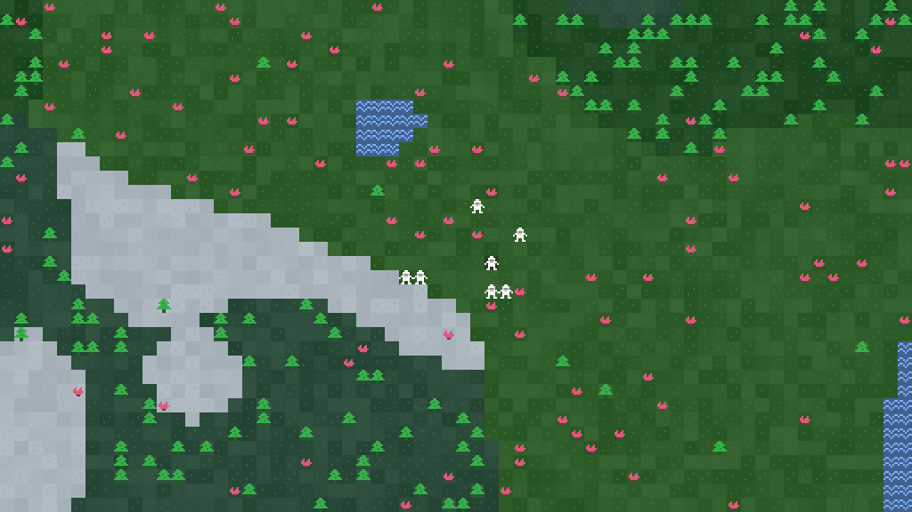
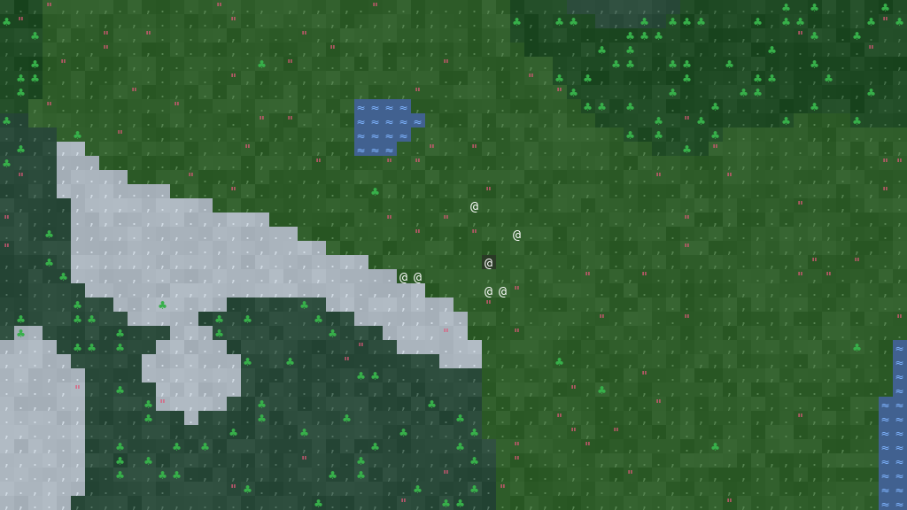
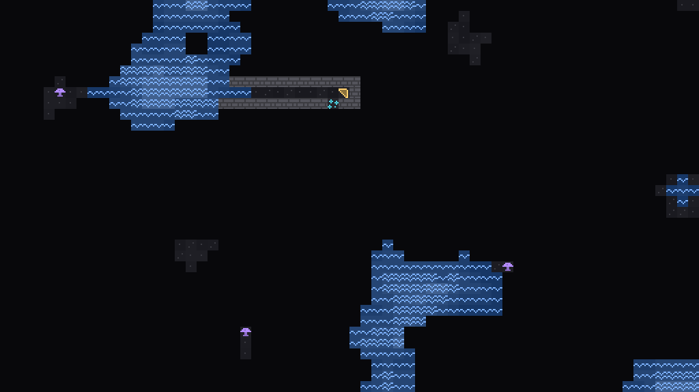

# Fortress: Godot spike (Phase 0)

This is a time-boxed trial port to **Godot 4.7.2 / GDScript**. It answers three questions before anyone commits to the full 4–7 week port:
1. Can GDScript reproduce the simulation exactly?
2. Is it fast enough?
3. Does the game look better in Godot?

It ports only the riskiest core and puts it on screen:
- seeded RNG and noise
- world generation
- the world model
- fluids
- 3D A* pathfinding
- the tile renderer

There are 20 stand-in dwarves that wander around, plus buttons that flood a cavern. There are no jobs, needs, AI, saving or real UI yet, so this is **not a playable game**.

The TypeScript game in `../src` is untouched and still the real game.



| | |
|---|---|
|  |  |

*Previews rendered headless by `tools/preview.gd`. They use the same tile visuals and atlases as the game, composed on the CPU.*

## Run it

1. Install [Godot 4.7.2](https://godotengine.org/download) (the standard build, not .NET).
2. Open `godot/project.godot` and press **F5**.

| Input | Action |
|---|---|
| Arrows / WASD, right- or middle-drag | pan (Shift: faster) |
| Wheel, PgUp/PgDn, `,` `.` | change level (0 = surface) |
| Ctrl+wheel, `+` `-` | zoom |
| Tab | ASCII ⇄ sprites |
| N | winter (snow, frozen lakes) |
| B / M | breach a water / magma pocket and jump to it |
| Space, 1–4 | pause, speed |
| H | back to the embark site |

The panel shows the following, and "Run bench" runs the benchmarks below inside the game:
- FPS and per-frame work
- generation and repaint times
- pathfinding cost
- the hovered tile

## Tests and benchmarks

From the repo root, with `godot` on your PATH (the sandbox used `.tools/godot`):

```bash
godot --headless --path godot --import                                                     # once
godot --headless --path godot -s addons/gut/gut_cmdln.gd -gdir=res://tests -gexit           # 19 tests
godot --headless --path godot -s tests/bench.gd                                            # benchmarks
BENCH=1 npx vitest run tests/bench.test.ts                                                 # node baseline
npx vitest run -u tests/golden.test.ts                                                     # regenerate fixtures
```

**How parity is tested.** `tests/golden.test.ts` (TS side) writes fixtures into `tests/fixtures/`, and the GDScript tests must reproduce them exactly. The fixtures cover:
- RNG sequences for 6 seeds
- 480 noise values, compared as raw float bits
- SHA-256 of every world layer for 4 world sizes
- 50 A* queries with full paths (stairs, doors, swimming, node caps, unreachable targets)
- 21 checkpoints across 4 fluid scenarios

The scenarios themselves live in `../tests/golden-scenarios.ts` and `dev/scenarios.gd`. **Keep the two in sync.**

**The tests catch real mistakes.** I deliberately broke the port three times, and each break was caught by a parity test while every ported behaviour test still passed:
- integer division in the generator
- a diagonal cost of 1.4142 instead of 1.414
- magma flowing every 3rd step instead of every 4th

## Results

These were measured in the sandbox (4 vCPU Linux, headless). Ranges cover repeated runs. Node's timings were noisy, especially for fluids (7–44 ms for the same work).

| # | Go/no-go check | Threshold | GDScript | Node (TS today) | Verdict |
|---|---|---|---|---|---|
| 1 | Bit-exact parity with TS | all fixtures | all pass (2,412 asserts) | n/a | **pass** |
| 2 | Generate a 100×100×10 world | ≤ 3 s | 0.55–0.62 s (large: 1.25–1.3 s) | 11–16 ms | **pass**, but ~45× slower |
| 3a | A* to an unreachable target, 12k node cap | ≤ 15 ms | 113–117 ms; **< 0.01 ms with region check** | 22–34 ms | **pass with region check** (see below) |
| 3b | A* typical reachable path | ≤ 2 ms | 1.05–1.17 ms | 0.15–0.22 ms | **pass**, ~5–6× slower |
| 4 | One fluid step after a breach | ≤ 2 ms | ~0.5 ms | 0.06–0.4 ms | **pass** |
| 5 | 60 fps panning and zooming a large map | 60 fps | **needs your machine** (z switch repaint 18–43 ms CPU) | n/a | open |
| 6 | Sprites look better than ASCII | your call | placeholder art only (see below) | n/a | open |

**Pathfinding (row 3).** The 15 ms threshold was too strict: node itself takes 22–34 ms for that search. GDScript is about 5× slower than V8 on A*.

The fix I added is `sim/nav/regions.gd`, which labels the connected walkable areas (in 55–65 ms on a large world). Searches for targets in another area are then refused in O(1), instead of exploring up to 12k tiles. In the TS game that worst case comes from unreachable jobs, which the job manager checks with a 12k node cap.

With the region check, the 50 random paths average 0.96 ms each instead of 6 ms. **Regions need incremental updates in Phase 1.** For now they're recomputed in full after a breach and every 200 fluid steps, which is a ~60 ms hitch on large maps.

**Exports.**

| Build | Size | Status |
|---|---|---|
| Linux (`build/linux/`) | 74 MB, one file with the game data embedded | runs headless without errors |
| Web, single-threaded (`build/web/`) | 39.5 MB `.wasm` (**10.1 MB gzipped**) + 0.3 MB pack | built but **not tested in a browser** (none in the sandbox) |

For comparison, the TS build is ~18 kB gzipped. Exports need the templates: Godot → Editor → Manage Export Templates.

**Graphics (row 6).** The sprite atlas is my own placeholder 8×8 pixel art, scaled to 16×16. Downloading Kenney's CC0 1-Bit Pack was blocked by the site's bot protection, and I didn't try to get around it. To judge the real thing:
1. Download a 16×16 sheet in a browser.
2. Write a small `glyph → [column, row]` map.
3. Run `uvx --with pillow python godot/tools/make_atlases.py --sheet sheet.png --map tiles.json --spacing 1`.

Tile N of `assets/tiles/sprites.png` is glyph N of `assets/tiles/atlas.json`, so nothing else changes.

### What the numbers say

GDScript is fast enough for this game at today's scale, *if* Phase 1 includes incremental region labels and world generation sits behind a loading message. Even then it leaves about 5× less CPU headroom than the TS version for pathfinding-heavy growth: more dwarves, bigger maps, smarter AI.

If that headroom becomes a problem, the escape hatch is moving `PathFinder` (and possibly `WorldGen`) into a C++ GDExtension. That costs one native build per platform, including web.

## Layout

```
sim/      pure logic, no nodes: core/ (I32, Rng, ValueNoise, Codec, TickClock), world/ (World, WorldGen,
          FluidSystem, Biome, Tile, WorldCalendar), nav/ (PathFinder, Regions), game/content.gd
view/     TileVisuals (port of renderer.ts tileCell), LevelRenderer (TileMapLayer + background image),
          CameraRig, SpikeWalkers (stand-in dwarves)
scenes/   main.tscn / main.gd: the spike scene; nodes and debug UI are built in code
dev/      Scenarios (mirror of tests/golden-scenarios.ts) and Bench, shared by tests and the game
tests/    GUT tests, fixtures/ from the TS side, bench.gd
tools/    make_atlases.py (atlas generator), preview.gd (headless PNG previews)
assets/   tiles/ (ascii.png, sprites.png, atlas.json), fonts/ (DejaVu Sans Mono)
addons/   GUT 9.7.1 (test framework)
```

## Porting notes for Phase 1

- **32-bit maths.** GDScript ints are 64-bit and wrap on overflow. Keep hashes and RNG state as u32 and use `I32.imul`; `>>` on a u32 then behaves like JS `>>>`.
- **Rounding.** `round()` sends halves away from zero, but JS sends them up. Use `I32.js_round` (needed in `climate.ts:42` and `components.ts:179`).
- **Integer division.** `x / 28` divides ints in GDScript; the TS divides floats. Write `x / 28.0`.
- **Ordering and sorting.** Dictionaries keep insertion order, even when a key is set again, so they stand in for JS `Set`/`Map`. `sort_custom` is not stable, so the job-manager sort (`job-manager.ts:110`) needs an index tie-break.
- **Packed arrays.** They're shared by reference. Reading a member array into a local (`var water := world.water`) is about 3× faster in hot loops.
- **Cell shape.** Cells are square 16×16, like Dwarf Fortress tilesets. The TS uses 10×19 text cells; glyphs and colours are otherwise identical.
